# Part 1: Regions and availability zones, step by step

Part 1 has 6 lessons. Each one is a short concept section followed by a hands-on lab. Plan on about 3–4 hours in total. Labs 3 and 4 create real resources, but they cost well under $1 if you delete them the same day.

Lab 3 uses [cloud-init.yaml](cloud-init.yaml) from this folder. It turns each test VM into a tiny web server that reports which zone it's running in.

Back to the full plan: [../overview.md](../overview.md)

---

## Step 0: Setup (10 min)

**0.1 Sign in to Azure:**

```bash
az login
```

**0.2 Choose a shell.** These commands use Bash syntax. Use **Git Bash** on your PC, or Azure Cloud Shell (Bash) in the portal. In Git Bash, run this once per session so it doesn't break Azure resource IDs:

```bash
export MSYS_NO_PATHCONV=1
```

**0.3 Create a budget alert first** (portal only). Go to **Cost Management → Budgets → Add**, set the amount to $10, and add an email alert at 80%.

**0.4 Set lab variables.** Pick a region near you that has zones, such as `southeastasia`, `eastus2` or `westeurope`:

```bash
LOC=southeastasia; RG=rg-part1-lab; echo "$LOC / $RG"
```

These variables only last for the current shell session. If you open a new terminal, set them again.

---

## Lesson 1: Regions, geographies and region pairs (30 min)

### Concept
- A **geography** (for example Asia Pacific) contains **regions** (Southeast Asia in Singapore, East Asia in Hong Kong).
- A **region pair** links two regions in the same geography, such as Southeast Asia ↔ East Asia or East US ↔ West US. Azure updates the two regions of a pair one at a time, recovers one of them first in a widespread outage, and GRS storage replicates to the pair automatically.
- Many **newer regions have no pair**. They rely on availability zones, and you replicate data to another region yourself.
- **Global services** are not tied to a region: Entra ID, Front Door, Traffic Manager and Azure DNS.

### Lab 1

**1.1 List every physical region** with its geography, pair and zone support:

```bash
az account list-locations --query "[?metadata.regionType=='Physical'].{Name:name, Geo:metadata.geographyGroup, Pair:metadata.pairedRegion[0].name, HasZones:availabilityZoneMappings!=null}" -o table
```

| Name | Geo | Pair | HasZones |
|---|---|---|---|
| eastus | US | westus | True |
| westus2 | US | westcentralus | True |
| australiaeast | Asia Pacific | australiasoutheast | True |
| southeastasia | Asia Pacific | eastasia | True |
| northeurope | Europe | westeurope | True |
| swedencentral | Europe | swedensouth | True |
| westeurope | Europe | northeurope | True |
| uksouth | UK | ukwest | True |
| centralus | US | eastus2 | True |
| southafricanorth | Africa | southafricawest | True |
| centralindia | Asia Pacific | southindia | True |
| eastasia | Asia Pacific | southeastasia | True |
| indiasouthcentral | Asia Pacific | centralindia | True |
| indonesiacentral | Asia Pacific |  | True |
| japaneast | Asia Pacific | japanwest | True |
| japanwest | Asia Pacific | japaneast | True |
| koreacentral | Asia Pacific | koreasouth | True |
| malaysiawest | Asia Pacific |  | True |
| newzealandnorth | Asia Pacific |  | True |
| canadacentral | Canada | canadaeast | True |
| austriaeast | Europe |  | True |
| belgiumcentral | Europe |  | True |
| denmarkeast | Europe |  | True |
| francecentral | Europe | francesouth | True |
| germanywestcentral | Europe | germanynorth | True |
| italynorth | Europe |  | True |
| norwayeast | Europe | norwaywest | True |
| polandcentral | Europe |  | True |
| spaincentral | Europe |  | True |
| switzerlandnorth | Europe | switzerlandwest | True |
| mexicocentral | Mexico |  | True |
| uaenorth | Middle East | uaecentral | True |
| brazilsouth | South America | southcentralus | True |
| chilecentral | South America |  | True |
| eastus2euap | US | centraluseuap | True |
| israelcentral | Middle East |  | True |
| qatarcentral | Middle East |  | True |
| eastus2 | US | centralus | True |
| eastusstg | US | southcentralusstg | False |
| southcentralus | US | northcentralus | True |
| westus3 | US | eastus | True |
| northcentralus | US | southcentralus | False |
| westus | US | eastus | False |
| jioindiawest | Asia Pacific | jioindiacentral | False |
| centraluseuap | US | eastus2euap | False |
| southcentralusstg | US | eastusstg | False |
| westcentralus | US | westus2 | False |
| southafricawest | Africa | southafricanorth | False |
| australiacentral | Asia Pacific | australiacentral2 | False |
| australiacentral2 | Asia Pacific | australiacentral | False |
| australiasoutheast | Asia Pacific | australiaeast | False |
| jioindiacentral | Asia Pacific | jioindiawest | False |
| koreasouth | Asia Pacific | koreacentral | False |
| southindia | Asia Pacific | centralindia | False |
| westindia | Asia Pacific | southindia | False |
| canadaeast | Canada | canadacentral | False |
| francesouth | Europe | francecentral | False |
| germanynorth | Europe | germanywestcentral | False |
| norwaywest | Europe | norwayeast | False |
| switzerlandwest | Europe | switzerlandnorth | False |
| uaecentral | Middle East | uaenorth | False |
| brazilsoutheast | South America | brazilsouth | False |
| ukwest | UK | uksouth | False |

**1.2 Show the regions with no pair:**

```bash
az account list-locations --query "[?metadata.regionType=='Physical' && metadata.pairedRegion[0].name==null].name" -o tsv
```

indonesiacentral <br>
malaysiawest <br>
newzealandnorth <br>
austriaeast <br>
belgiumcentral <br>
denmarkeast <br>
italynorth <br>
polandcentral <br>
spaincentral <br>
mexicocentral <br>
chilecentral <br>
israelcentral <br>
qatarcentral

**1.3 Compare prices between regions.** Open the [Azure Pricing Calculator](https://azure.microsoft.com/pricing/calculator/), add a `D2s_v5` Linux VM, and switch between 3 regions. Note how much the price changes.

**✅ Write down:**
1. 3 regions with zones and 3 without.
   - **With zones:** `southeastasia`, `eastasia`, `koreacentral`
   - **Without zones:** `koreasouth`, `southindia`, `ukwest`
2. Your chosen region's pair, or "none".
   - `southeastasia` is paired with `eastasia`.
3. Which of your 3 regions is cheapest.
   - **`koreacentral`**, for a `D2s_v5` Linux VM on pay-as-you-go. East Asia costs about 12% more than Korea Central.

   | Region |  Per month, 730 hours (USD) |
   |---|---|
   | `koreacentral` | $153.3 |
   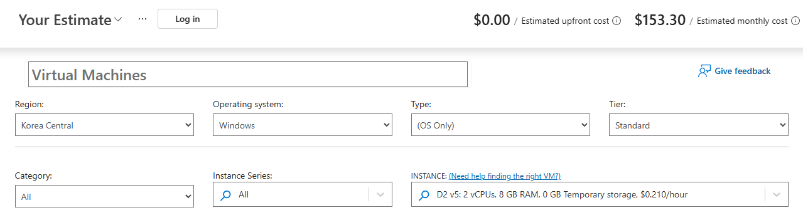
   | `southeastasia` | $154.76 |
   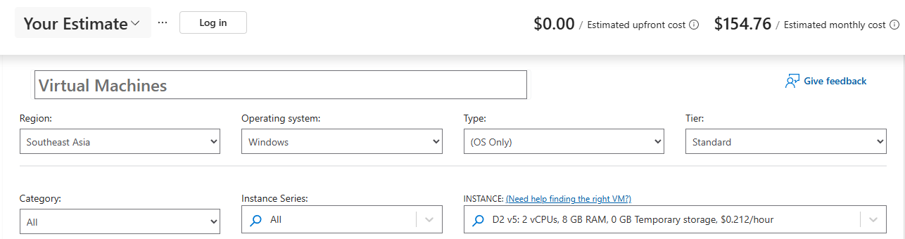
   | `eastasia` |  $163.52 |
   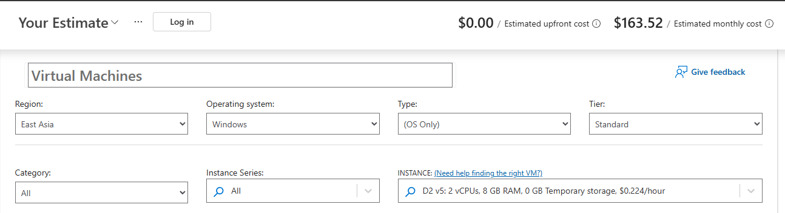

---

## Lesson 2: Availability zones (30 min)

### Concept
- A **zone** is one or more datacenters with their own power, cooling and networking. A region has up to 3 zones.
- There are three ways a resource can relate to zones:
  - **Zonal:** you pin the resource to a zone, for example `--zone 1`. If that zone fails, the resource goes down with it.
  - **Zone-redundant:** Azure spreads the resource across zones for you. Examples are ZRS storage, Standard Load Balancer and Standard Public IP.
  - **Non-zonal:** Azure makes no promise about which zone the resource is in.
- **Logical and physical zones are different.** Your "zone 1" may be a different physical datacenter than another subscription's "zone 1".
- **VM sizes vary by zone.** Not every VM size is available in every zone.

### Lab 2

**2.1 See how your logical zones map to physical zones:**

```bash
az account list-locations --query "[?name=='$LOC'].availabilityZoneMappings[]" -o table
```
| LogicalZone |  PhysicalZone |
|---|---|
|1   | southeastasia-az2
|2   | southeastasia-az3
|3   | southeastasia-az1

**2.2 Check which zones offer the lab VM size.** Look at the **Zones** and **Restrictions** columns:

```bash
az vm list-skus --location $LOC --size Standard_B1s --resource-type virtualMachines -o table
```

|ResourceType   |  Locations    |   Name       |    Zones  |  Restrictions |
|---------------|  -------------| ------------ | -------   | --------------|
|virtualMachines|  southeastasia|  Standard_B1s|  1,2,3    |    None       |

If Restrictions shows `NotAvailableForSubscription`, try `Standard_B1ms` or `Standard_B2ats_v2`, or change `LOC` to another region.

**2.3 Check your vCPU quota.** Free trial subscriptions often get only 4 vCPUs per region:

```bash
az vm list-usage --location $LOC --query "[?contains(name.value,'cores')].{Name:localName, Used:currentValue, Limit:limit}" -o table
```

|Name                  | Used   |  Limit
|--------------------  |------  |-------
|Total Regional vCPUs  |0       |10

**✅ Write down:**
1. The physical zone name behind your logical zone 1.
   - Logical zone 1 is `southeastasia-az2`. Logical zone 2 is `southeastasia-az3`, and logical zone 3 is `southeastasia-az1`.
2. Which zones support your VM size.
   - `Standard_B1s` is available in zones 1, 2 and 3 of `southeastasia`, with no restrictions.
3. Your regional vCPU limit.
   - 10 vCPUs in `southeastasia`, with 0 in use.

---

## Lesson 3: Zone-redundant web app with a load balancer (60 min, the main lab)

Here's what you'll build:

```
Internet → Public IP (Standard, zone-redundant)
             → Standard Load Balancer (health probe on port 80)
                 ├─ vm-web-1 (zone 1)
                 └─ vm-web-2 (zone 2)
```

**3.1 Create a resource group and a virtual network:**

```bash
az group create -n $RG -l $LOC
```

```bash
az network vnet create -g $RG -n vnet-lab --address-prefix 10.0.0.0/16 --subnet-name snet-web --subnet-prefix 10.0.1.0/24
```

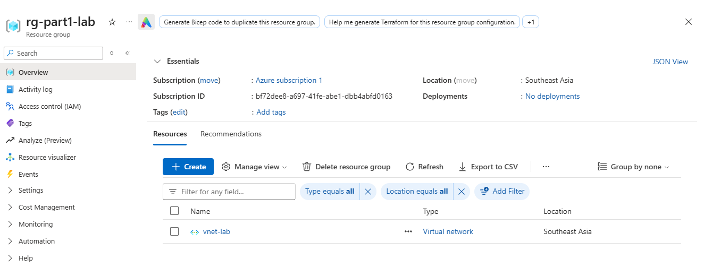

**3.2 Create a network security group that allows HTTP, and attach it to the subnet:**

```bash
az network nsg create -g $RG -n nsg-web
```

```bash
az network nsg rule create -g $RG --nsg-name nsg-web -n allow-http --priority 100 --protocol Tcp --destination-port-ranges 80 --access Allow
```

```bash
az network vnet subnet update -g $RG --vnet-name vnet-lab -n snet-web --network-security-group nsg-web
```

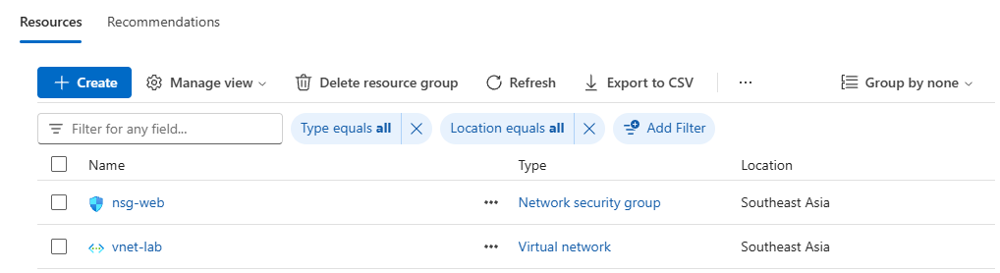

**3.3 Create a zone-redundant public IP and a Standard Load Balancer:**

```bash
az network public-ip create -g $RG -n pip-lb --sku Standard --zone 1 2 3
```

```bash
az network lb create -g $RG -n lb-web --sku Standard --public-ip-address pip-lb --frontend-ip-name fe --backend-pool-name be
```

```bash
az network lb probe create -g $RG --lb-name lb-web -n probe-http --protocol Http --port 80 --path /
```

```bash
az network lb rule create -g $RG --lb-name lb-web -n rule-http --protocol Tcp --frontend-port 80 --backend-port 80 --frontend-ip-name fe --backend-pool-name be --probe-name probe-http
```

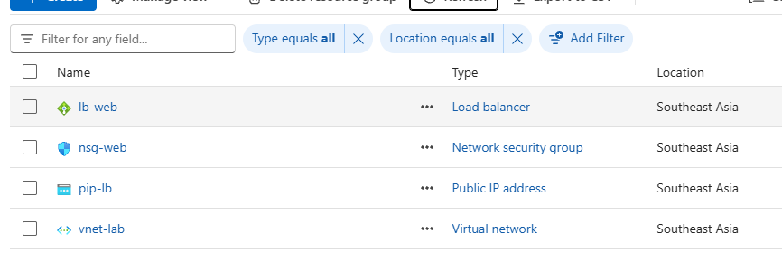

**3.4 Create 2 VMs in different zones.** Run this from the `part1` folder so the cloud-init file is found. The VMs get no public IP, so they're reachable only through the load balancer.

```bash
cd "/d/LEARN BY MYSELF/Azure/part1"
```

```bash
for i in 1 2; do az vm create -g $RG -n vm-web-$i --image Ubuntu2204 --size Standard_B1s --zone $i --vnet-name vnet-lab --subnet snet-web --public-ip-address "" --nsg "" --admin-username azureuser --generate-ssh-keys --custom-data cloud-init.yaml; done
```

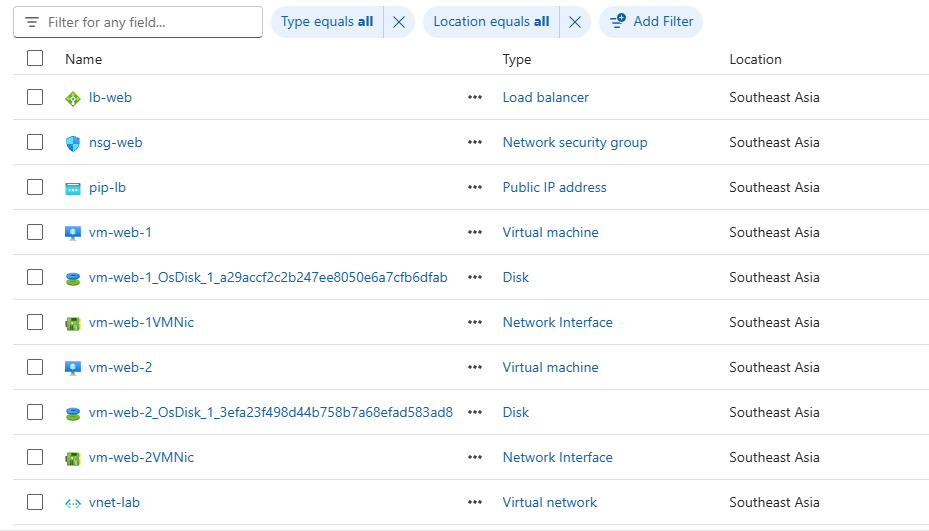

**3.5 Add both VMs to the load balancer's backend pool:**

```bash
for i in 1 2; do az network nic ip-config address-pool add -g $RG --nic-name vm-web-${i}VMNic --ip-config-name ipconfigvm-web-$i --lb-name lb-web --address-pool be; done
```

**3.6 Test it.** Wait 2–3 minutes for cloud-init to finish, then send 8 requests:

```bash
PIP=$(az network public-ip show -g $RG -n pip-lb --query ipAddress -o tsv); for n in {1..8}; do curl -s --max-time 5 http://$PIP; done
```

You should see responses from both `vm-web-1 - zone 1` and `vm-web-2 - zone 2`.

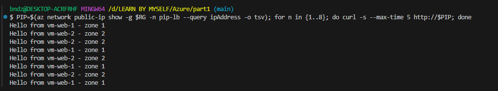

**3.7 Simulate a zone failure** by deallocating the VM in zone 1:

```bash
az vm deallocate -g $RG -n vm-web-1
```

```bash
for n in {1..8}; do curl -s --max-time 5 http://$PIP; done
```

Now only zone 2 answers. The health probe noticed the failure and the site stayed up. Start the VM again and confirm that zone 1 comes back into the responses:

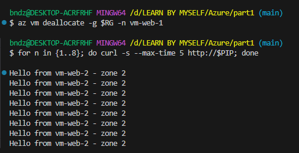

```bash
az vm start -g $RG -n vm-web-1
```

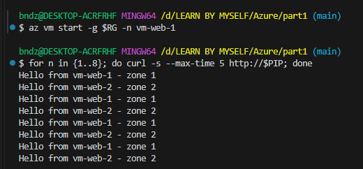

**3.8 Look at it in the portal.** Open **Load balancer → Insights** to see the health probe status for each VM.

**✅ Answer:**
1. Why must the Load Balancer and Public IP use the **Standard** SKU?
2. What would happen with both VMs in zone 1?
3. What is the SLA for this setup?

---

## Lesson 4: Availability sets (30 min)

### Concept
- An availability set protects VMs **inside one datacenter**. It spreads them across:
  - **Fault domains (FD):** separate racks with separate power and network switches. There are up to 3 per set.
  - **Update domains (UD):** groups of VMs that are rebooted at different times during maintenance. There are up to 20 per set.
- **A VM can't be in an availability set and a zone at the same time.**
- Today, zones (99.99% SLA) or scale sets are usually preferred. Availability sets (99.95%) still appear in exams and older systems.

### Lab 4
If your quota is only 4 vCPUs, you're already using 2 for the zone VMs, so this lab fits.

**4.1 Create the availability set:**

```bash
az vm availability-set create -g $RG -n avset-lab --platform-fault-domain-count 2 --platform-update-domain-count 5
```

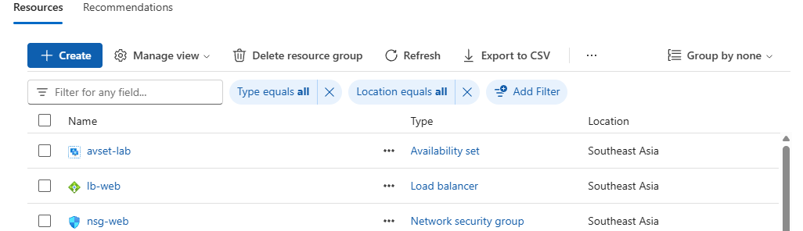

**4.2 Create 2 VMs in it:**

```bash
for i in 1 2; do az vm create -g $RG -n vm-avs-$i --image Ubuntu2204 --size Standard_B1s --availability-set avset-lab --vnet-name vnet-lab --subnet snet-web --public-ip-address "" --nsg "" --admin-username azureuser --generate-ssh-keys; done
```

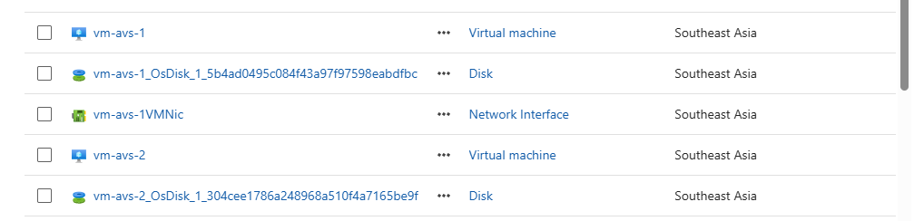

**4.3 See which fault domain and update domain each VM landed in:**

```bash
for i in 1 2; do az vm get-instance-view -g $RG -n vm-avs-$i --query "{VM:name, FD:instanceView.platformFaultDomain, UD:instanceView.platformUpdateDomain}" -o table; done
```

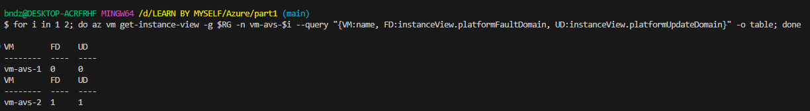

**4.4 Break it on purpose.** Try to create a VM with both `--zone 1` and `--availability-set avset-lab`, and read the error.

**✅ Answer:**
1. Which failures does an availability set protect against?
2. Which failures does it **not** protect against? (Hint: a whole datacenter going down.)

---

## Lesson 5: SLA math (30 min, paper exercise)

### The rules

| Setup | Formula |
|---|---|
| Services in **series** (A calls B) | A × B |
| Services in **parallel** (redundant copies) | 1 − (1−A)(1−B) |

### Downtime per year

| SLA | Allowed downtime per year |
|---|---|
| 99.9% | 8.76 h |
| 99.95% | 4.38 h |
| 99.99% | 52.6 min |
| 99.999% | 5.26 min |

### Problems
Try these before you read the answers.

1. An app has three tiers in a chain: App Service 99.95% → Azure SQL 99.99% → Storage 99.9%. What is the composite SLA, and what downtime does it allow per year?
2. You copy the whole stack from Problem 1 into a second region and run both regions active-active. What is the new SLA?
3. You put Front Door (99.99%) in front of both regions from Problem 2. What is the final SLA?
4. Compare these setups: one VM with Premium SSD, 2 VMs in an availability set, and 2 VMs across zones.

<details><summary>Answers</summary>

1. 0.9995 × 0.9999 × 0.999 = **99.84%**, about 14 h of downtime per year. The weakest link (Storage at 99.9%) drags the result down.
2. 1 − (0.0016)² = **99.9997%**
3. 0.999997 × 0.9999 ≈ **99.99%**. The global entry point becomes the limit, because adding more regions can't push the result past the SLA of the component they all depend on.
4. One VM: 99.9%. Availability set: 99.95%. Across zones: 99.99%.
</details>

---

## Lesson 6: Write a disaster recovery plan (30 min)

### Concept
- **RTO** (Recovery Time Objective): the longest you can be down.
- **RPO** (Recovery Point Objective): how much data you can afford to lose.

| Pattern | RTO | Cost |
|---|---|---|
| Backup/restore | Hours to days | $ |
| Pilot light | Hours | $$ |
| Warm standby | Minutes | $$$ |
| Active-active | ~0 | $$$$ |

### Exercise
Write the plan in a new file, `part1/dr-plan.md`.

**Scenario:** an online shop with a web app, a SQL database and product images. The business requires **RTO = 1 hour and RPO = 15 minutes**, and most customers are in Southeast Asia.

Your plan should cover:
1. The primary and secondary region, and why you chose each.
2. The DR pattern, and why the cheaper patterns don't meet the requirement.
3. How each tier is protected:
   - **Web:** zone-redundant App Service, plus a standby in the second region.
   - **SQL:** zone-redundant, plus an auto-failover group.
   - **Images:** RA-GZRS storage.
   - **Entry point:** Front Door.
4. The composite SLA, using the method from Lesson 5.
5. How you would **test** a failover.

---

## Cleanup (do this the same day)

Delete the resource group and everything in it:

```bash
az group delete -n $RG --yes --no-wait
```

Confirm it's gone:

```bash
az group list -o table
```

---

## Self-check
You've finished Part 1 when you can answer these without looking anything up:

1. What is the difference between a region, a zone and a region pair?
2. How do zonal, zone-redundant and non-zonal resources differ? Give one example of each.
3. Why can your "zone 1" be a different datacenter than a colleague's "zone 1"?
4. How do fault domains and update domains differ, and when would you still use an availability set?
5. Calculate a composite SLA for services in series and in parallel.
6. Define RTO and RPO, and pick a DR pattern to match a given pair of values.
7. Name 4 things to weigh when choosing a region.
