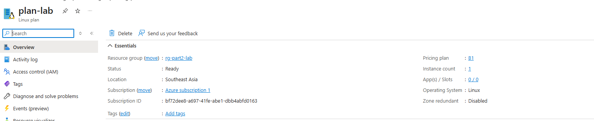
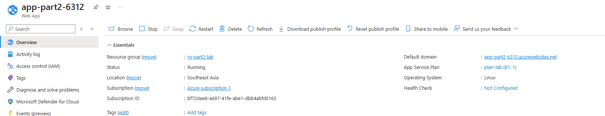
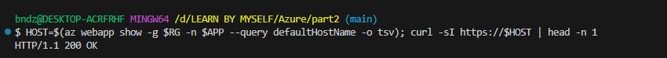
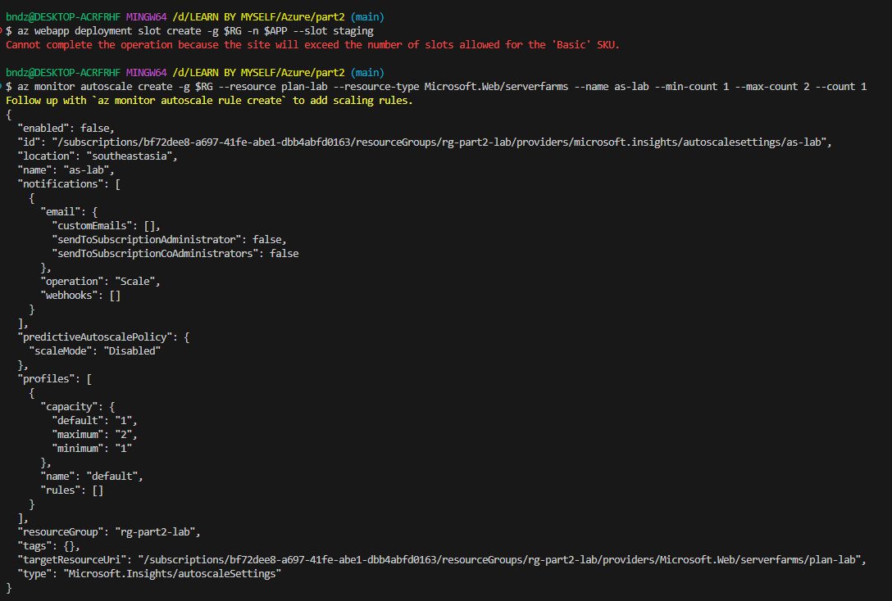
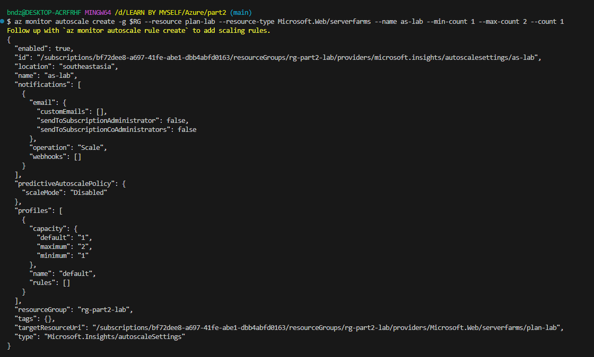
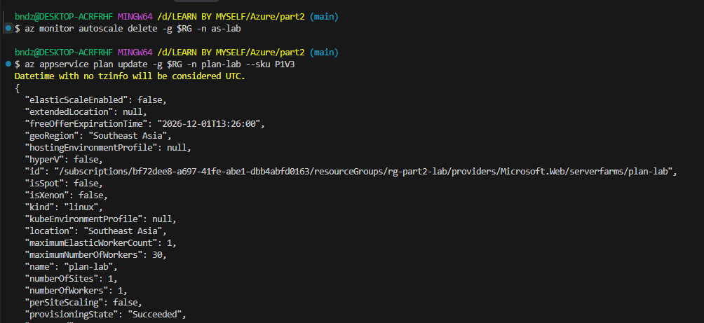

# Part 2: Service tiers, step by step

Part 2 has 5 lessons, which cover Exercises 7–12. Each one is a short concept section followed by a hands-on lab. Plan on about 3–4 hours in total. Labs 1–3 create real resources, but they cost well under $1 if you delete them the same day. Lessons 4 and 5 create nothing.

Lab 3 uses [lifecycle-policy.json](lifecycle-policy.json) from this folder.

Keep asking one question throughout this part: **why would I pay for the next tier up?**

Back to the full plan: [../overview.md](../overview.md)

---

## Step 0: Setup and budget (10 min, Exercise 11)

**0.1 Create a budget alert first** (portal only). Go to **Cost Management → Budgets → Add**, set the amount to $10, and add an email alert at 80%. A budget only sends alerts. It doesn't stop any spending.

Confirm it exists:

```bash
az consumption budget list --query "[].{Name:name, Amount:amount}" -o table
```

**0.2 Open Git Bash**, sign in if needed, and stop Git Bash from rewriting Azure resource IDs:

```bash
az login
```

```bash
export MSYS_NO_PATHCONV=1
```

**0.3 Go to this folder and set the lab variables.** Storage account and web app names must be globally unique, so `$RANDOM` adds a number to each:

```bash
cd "/d/LEARN BY MYSELF/Azure/part2"
```

```bash
LOC=southeastasia; RG=rg-part2-lab; APP=app-part2-$RANDOM; ST=stpart2$RANDOM; ST2=stzrs$RANDOM; echo "$LOC / $RG / $APP / $ST / $ST2"
```

These variables only last for the current shell session. Keep the printed line, so you can set the same names again if you open a new terminal.

**0.4 Create the resource group:**

```bash
az group create -n $RG -l $LOC
```

---

## Lesson 1: App Service plan tiers (60 min, Exercise 7)

### Concept
- An **App Service plan** is the set of VMs your apps run on. You pay for the plan, not for each app.
- **Scale up** changes the tier, which gives you more power and more features. **Scale out** adds instances.
- Each tier unlocks something:

| Tier | Max instances | Deployment slots | Autoscale | Zone redundancy |
|---|---|---|---|---|
| Basic (B1) | 3 | None | No | No |
| Standard (S1) | 10 | 5 | Yes | No |
| Premium v3 (P1v3) | 30 | 20 | Yes | Yes, with at least 2 instances |

- A **deployment slot** is a live copy of your app, such as `staging`, that you can swap into production with no downtime.
- **Zone redundancy has no separate charge**, but it needs at least 2 instances, and you pay for both.

### Lab 1

**1.1 Create a B1 plan and a web app:**

```bash
az appservice plan create -g $RG -n plan-lab --is-linux --sku B1
```



```bash
az webapp create -g $RG -p plan-lab -n $APP --runtime "NODE:22-lts"
```



Check that it responds. You should see `HTTP/1.1 200 OK`:

```bash
HOST=$(az webapp show -g $RG -n $APP --query defaultHostName -o tsv); curl -sI https://$HOST | head -n 1
```



**1.2 Try the features B1 doesn't have.** Both of these should be refused. Read each error:

```bash
az webapp deployment slot create -g $RG -n $APP --slot staging
```

```bash
az monitor autoscale create -g $RG --resource plan-lab --resource-type Microsoft.Web/serverfarms --name as-lab --min-count 1 --max-count 2 --count 1
```



**1.3 Scale up to S1 and run the same two commands again.** This time they should work:

```bash
az appservice plan update -g $RG -n plan-lab --sku S1
```

```bash
az webapp deployment slot create -g $RG -n $APP --slot staging
```

```bash
az monitor autoscale create -g $RG --resource plan-lab --resource-type Microsoft.Web/serverfarms --name as-lab --min-count 1 --max-count 2 --count 1
```



**1.4 Scale up to P1v3.** Delete the autoscale setting first, because it would conflict with the zone redundancy step:

```bash
az monitor autoscale delete -g $RG -n as-lab
```

```bash
az appservice plan update -g $RG -n plan-lab --sku P1V3
```




**1.5 Check for zone redundancy support, then turn it on.** A result above 1 means it's supported:

```bash
az appservice plan show -g $RG -n plan-lab --query properties.maximumNumberOfZones
```

```bash
az appservice plan update -g $RG -n plan-lab --set zoneRedundant=true sku.capacity=2
```

If the result was 1, skip the second command. To get zone redundancy, you'd need a new plan in a new resource group.

**1.6 Scale back down.** Try this while the slot still exists, and read the error:

```bash
az appservice plan update -g $RG -n plan-lab --set zoneRedundant=false sku.capacity=1
```

```bash
az appservice plan update -g $RG -n plan-lab --sku B1
```

Now delete the slot and try again:

```bash
az webapp deployment slot delete -g $RG -n $APP --slot staging
```

```bash
az appservice plan update -g $RG -n plan-lab --sku B1
```

**✅ Answer:**
1. What did S1 unlock over B1, and what did P1v3 unlock over S1?
2. Why did scaling down fail while the slot existed?
3. Does a zone-redundant plan cost more per instance? Why might your bill still go up?

---

## Lesson 2: Storage redundancy and access tiers (60 min, Exercise 8)

### Concept

**Redundancy** decides how many copies of your data exist and where:

| Option | Copies are kept | Survives a zone failure | Survives a region failure |
|---|---|---|---|
| **LRS** | In one datacenter | No | No |
| **ZRS** | Across zones | Yes | No |
| **GRS** | LRS, plus a second region | No, until failover | Yes, after failover |
| **GZRS** | ZRS, plus a second region | Yes | Yes, after failover |

The **RA-** versions (RA-GRS, RA-GZRS) also let you read from the second region at any time.

**Changing redundancy** works in two different ways:
- **Adding or removing geo-replication** (LRS ↔ GRS) is a simple account update.
- **Adding or removing zone redundancy** (LRS ↔ ZRS) is a **conversion**. It usually starts within 72 hours, and Microsoft doesn't guarantee when it finishes.
- GRS → ZRS takes two steps: GRS → LRS, then a conversion to ZRS.

**Access tiers** trade storage cost against access cost:

| Tier | Availability of data | Minimum stay | Redundancy supported |
|---|---|---|---|
| Hot | Immediate | None | All |
| Cool | Immediate | 30 days | All |
| Cold | Immediate | 90 days | All |
| Archive | **Offline**, up to 15 hours to rehydrate | 180 days | **LRS, GRS and RA-GRS only** |

If a blob leaves a tier before the minimum stay, you pay an early deletion charge for the remaining days. For the tiny file in this lab, that's a fraction of a cent.

### Lab 2

**2.1 Create an LRS account, a container and a blob.** `--auth-mode key` means you don't need an extra role assignment for this lab:

```bash
az storage account create -g $RG -n $ST -l $LOC --sku Standard_LRS --kind StorageV2 --access-tier Hot --min-tls-version TLS1_2 --allow-blob-public-access false
```

```bash
az storage container create --account-name $ST -n demo --auth-mode key
```

```bash
echo "hello tiers" > hello.txt
```

```bash
az storage blob upload --account-name $ST -c demo -n hello.txt -f hello.txt --auth-mode key
```

**2.2 Change the redundancy.** Geo-replication is a simple update, so these should work straight away:

```bash
az storage account update -g $RG -n $ST --sku Standard_GRS
```

```bash
az storage account update -g $RG -n $ST --sku Standard_LRS
```

**2.3 See how the zone redundancy conversion is different.** Open the account in the portal and go to **Data management → Redundancy**. Look at the options and the notes beside them, but **don't save a change**. A conversion could outlast this lab, and a ZRS account can't do the Archive steps below.

The CLI command for it is `az storage account migration start`. You don't need to run it here.

**2.4 Move the blob Hot → Cool → Archive,** and check its tier after each move:

```bash
az storage blob show --account-name $ST -c demo -n hello.txt --auth-mode key --query "properties.blobTier" -o tsv
```

```bash
az storage blob set-tier --account-name $ST -c demo -n hello.txt --tier Cool --auth-mode key
```

```bash
az storage blob show --account-name $ST -c demo -n hello.txt --auth-mode key --query "properties.blobTier" -o tsv
```

```bash
az storage blob set-tier --account-name $ST -c demo -n hello.txt --tier Archive --auth-mode key
```

```bash
az storage blob show --account-name $ST -c demo -n hello.txt --auth-mode key --query "properties.blobTier" -o tsv
```

**2.5 Try to read the archived blob.** This should fail with a `BlobArchived` error. You can still see its properties, as step 2.4 just showed, but not its contents:

```bash
az storage blob download --account-name $ST -c demo -n hello.txt -f out.txt --auth-mode key
```

**2.6 Try to add geo-replication now.** This time it should be refused, because the account has a blob that was archived while on LRS:

```bash
az storage account update -g $RG -n $ST --sku Standard_GRS
```

**2.7 Start a rehydration and check its status.** It can take up to 15 hours on Standard priority, so don't wait for it:

```bash
az storage blob set-tier --account-name $ST -c demo -n hello.txt --tier Hot --rehydrate-priority Standard --auth-mode key
```

```bash
az storage blob show --account-name $ST -c demo -n hello.txt --auth-mode key --query "properties.{Tier:blobTier, Status:rehydrationStatus}" -o table
```

**2.8 Confirm that ZRS can't use Archive.** Create a ZRS account, upload the same file, and try to archive it. The last command should fail:

```bash
az storage account create -g $RG -n $ST2 -l $LOC --sku Standard_ZRS --kind StorageV2 --access-tier Hot --min-tls-version TLS1_2 --allow-blob-public-access false
```

```bash
az storage container create --account-name $ST2 -n demo --auth-mode key
```

```bash
az storage blob upload --account-name $ST2 -c demo -n hello.txt -f hello.txt --auth-mode key
```

```bash
az storage blob set-tier --account-name $ST2 -c demo -n hello.txt --tier Archive --auth-mode key
```

**✅ Answer:**
1. Which conversions were instant, and which would need a conversion process?
2. Why is it risky to archive blobs before you've settled on a redundancy option?
3. Which failure does each of LRS, ZRS, GRS and GZRS survive?
4. A blob moves to Archive and is deleted after 45 days. How many days of early deletion charge do you pay?

---

## Lesson 3: Lifecycle management (20 min, Exercise 9)

### Concept
- A **lifecycle policy** moves or deletes blobs automatically, based on rules such as age.
- Policies run about once a day, and a new policy can take 24 hours or more to start acting.
- A policy can't rehydrate a blob from Archive.
- Plan the days around the minimum stays. Otherwise the policy itself triggers early deletion charges.

### Lab 3

**3.1 Read the policy** in [lifecycle-policy.json](lifecycle-policy.json). It applies to block blobs in the `demo` container: Cool after 30 days, Archive after 90, and deleted after 365.

**3.2 Apply it to the LRS account:**

```bash
az storage account management-policy create -g $RG --account-name $ST --policy @lifecycle-policy.json
```

**3.3 Confirm it was saved:**

```bash
az storage account management-policy show -g $RG --account-name $ST --query "policy.rules[].{Name:name, Enabled:enabled}" -o table
```

You won't see any blob move during this lab, because the rules start at 30 days. In the portal, you can review the rule under **Data management → Lifecycle management**.

**✅ Answer:**
1. A blob spends 60 days in Cool and 275 in Archive under this policy. Does it trigger an early deletion charge? Why or why not?
2. What would happen if the policy deleted blobs after 200 days instead?
3. What should this policy do differently on a ZRS account?

---

## Cleanup (do this straight after Lesson 3)

Lessons 4 and 5 need no resources, so delete everything now. Only this lab's group is deleted, so your `bndzSSHKey` group is safe:

```bash
az group delete -n $RG --yes --no-wait
```

Confirm it's gone. It can take a few minutes to disappear:

```bash
az group list -o table
```

Remove the local test files:

```bash
rm -f hello.txt out.txt
```

---

## Lesson 4: VM sizes and pricing models (40 min, Exercise 10)

### Concept

**Reading a VM name.** Take `Standard_D4s_v5` as an example:

| Part | Meaning |
|---|---|
| `D` | Family: general purpose |
| `4` | 4 vCPUs |
| `s` | Supports Premium SSD |
| `v5` | Hardware generation |

The main families are B (burstable), D (general purpose), E (memory), F (compute), L (storage), N (GPU) and M (huge memory).

**Pricing models:**

| Model | How it works | The catch |
|---|---|---|
| Pay-as-you-go | Pay by the second | Highest price |
| Reservation | Commit to a specific size and region for 1 or 3 years | You pay even if you don't use it |
| Savings plan | Commit to an hourly spend for 1 or 3 years | Usually a smaller discount than a reservation, but more flexible |
| Spot | Use spare capacity at a large discount | Azure can evict the VM at any time, and there's no SLA |
| Azure Hybrid Benefit | Bring your existing Windows Server or SQL Server licenses | You need to own eligible licenses |
| Dev/Test | Lower rates for non-production work | Only on eligible subscriptions |

### Lab 4
This is all in the [Azure Pricing Calculator](https://azure.microsoft.com/pricing/calculator/), so nothing is deployed.

**4.1 Add a `D4s_v5` Linux VM** in your region and note the monthly price for each option in this table:

| Option | Your region | Region 2 | Region 3 |
|---|---|---|---|
| Pay-as-you-go | | | |
| 3-year reservation | | | |
| Spot | | | |

**4.2 Work out the savings** of the reservation and of Spot against pay-as-you-go, as percentages.

**✅ Answer:**
1. Which workloads suit Spot, and which should never run on it?
2. How many hours a month must a VM run before a 3-year reservation beats pay-as-you-go?
3. Is the cheapest region a good choice for your users? Use the factors from Part 1 to explain.

---

## Lesson 5: Azure SQL, General Purpose or Business Critical (30 min, Exercise 12)

### Concept

Azure SQL has two ways to buy: **DTU** (a bundled measure, in Basic, Standard and Premium) and **vCore** (you choose compute and storage separately). This lesson compares two vCore tiers:

| | General Purpose | Business Critical |
|---|---|---|
| Architecture | Stateless compute, with files in remote Azure storage | A cluster of 4 nodes, each with local SSD storage |
| Storage latency | 5–10 ms | 1–2 ms |
| Max IOPS | 16,000 | 327,680 |
| On failure | Compute moves to a spare node and starts with a cold cache | A secondary replica becomes the primary immediately |
| Free read replica | No | Yes, 1 |
| In-memory tables | No | Yes |
| Compute price | Baseline | About 2.7 times higher |

Both support zone redundancy. Microsoft now recommends a third tier, **Hyperscale**, as the default for new OLTP workloads, so mention it in your answer.

### Lab 5

**5.1 List the sizes offered in your region.** This only reads data:

```bash
az sql db list-editions -l $LOC --edition GeneralPurpose --available -o table
```

```bash
az sql db list-editions -l $LOC --edition BusinessCritical --available -o table
```

**5.2 Compare prices.** In the [Pricing Calculator](https://azure.microsoft.com/pricing/calculator/), price a 2-vCore, 32 GB single database on each tier, first without and then with zone redundancy.

**5.3 Check the SLAs** on the [SLA page](https://www.microsoft.com/licensing/docs/view/Service-Level-Agreements-SLA-for-Online-Services) for each tier, with and without zone redundancy.

### Exercise
Write a short recommendation in a new file, `part2/sql-recommendation.md`.

**Scenario:** the online shop from your Part 1 DR plan, with a 1-hour RTO and a 15-minute RPO. Say which tier you'd choose and cover:
1. A comparison of HA architecture, zone redundancy and read replicas.
2. The monthly price difference you found.
3. What would make you change your mind, such as needing 1–2 ms latency or heavy reporting queries.
4. Whether Hyperscale would be a better fit, and why.

---

## Self-check
You've finished Part 2 when you can answer these without looking anything up:

1. What does each App Service step (Basic → Standard → Premium v3) unlock?
2. What is the difference between scaling up and scaling out?
3. Which failures do LRS, ZRS, GRS and GZRS each survive, and what does RA- add?
4. Which redundancy changes are simple updates, and which need a conversion?
5. How do the four access tiers differ, and why can't you read an archived blob directly?
6. What does `Standard_D4s_v5` mean?
7. When would you choose a reservation, a savings plan or Spot?
8. When is Business Critical worth about 2.7 times the compute price of General Purpose?
9. For the services this guide didn't cover in the [overview's tier table](../overview.md) (Managed Disks, networking, Key Vault, API Management and Cosmos DB), why would you pay for the next tier up?
